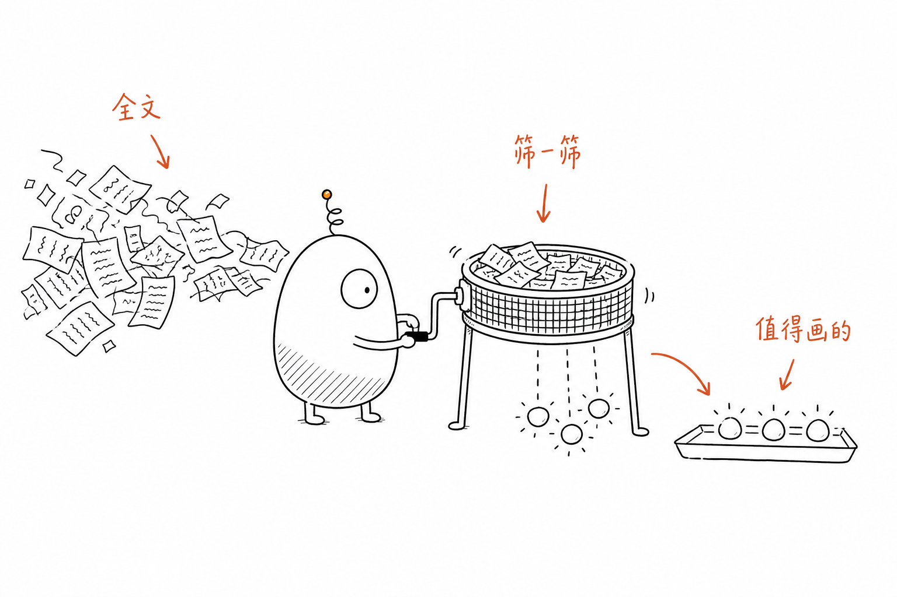
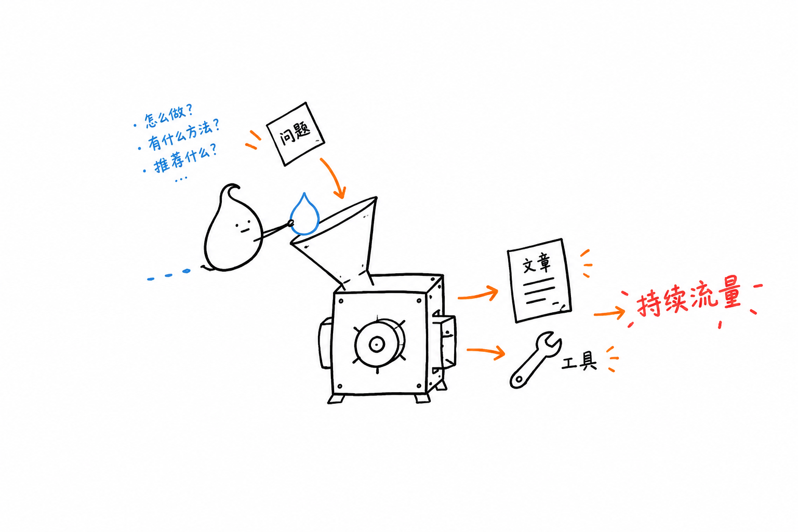
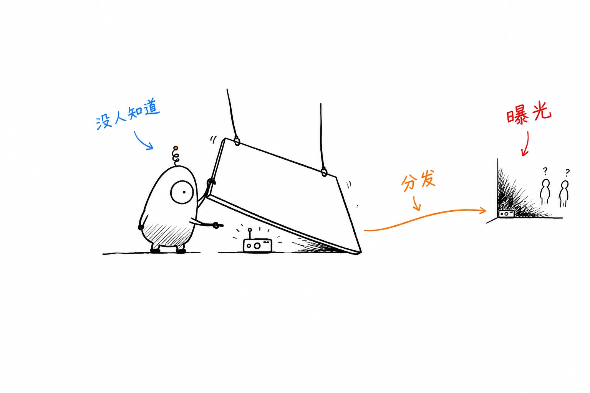
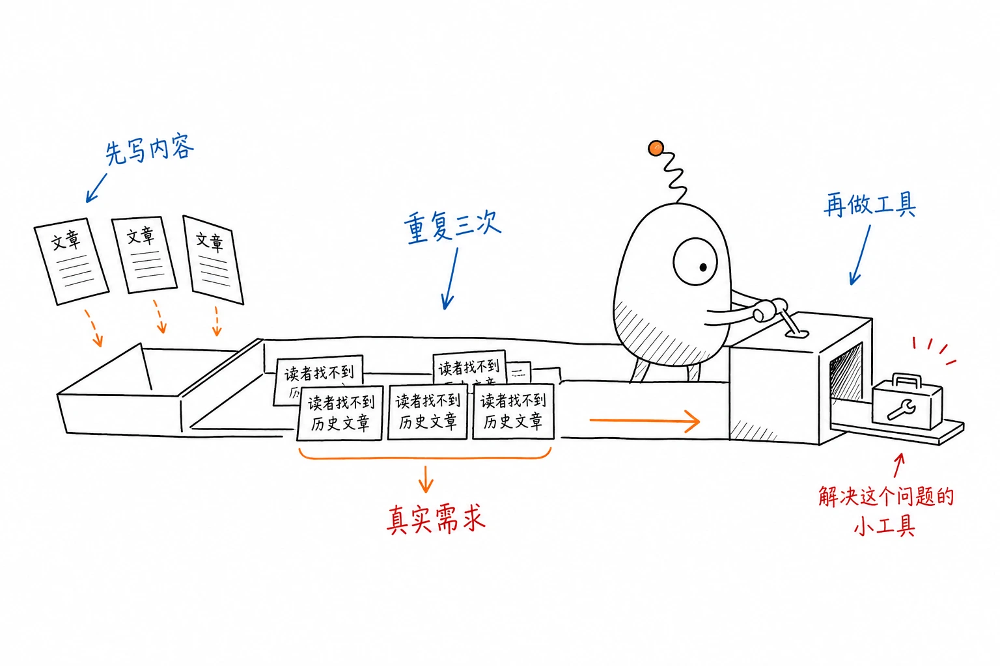
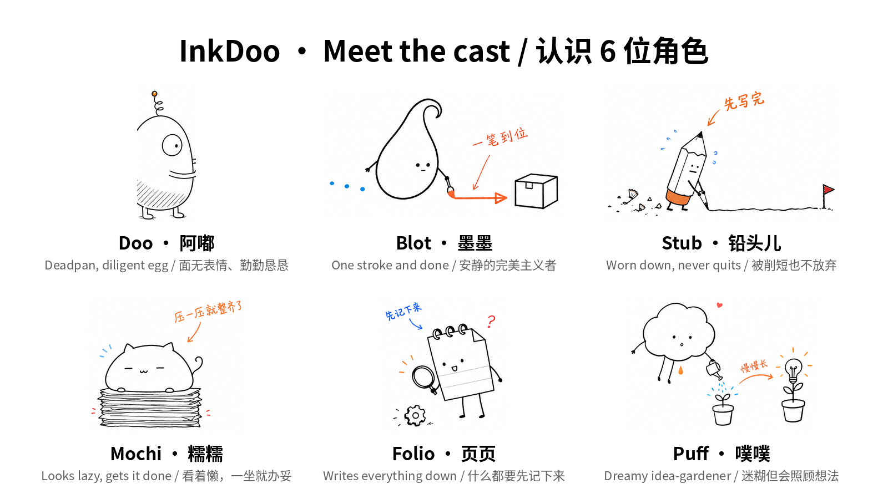

> 在线阅读（GitHub Pages）：https://maynor996.github.io/character-consistent-images/

# 文章配图总是一张一个画风？聊聊“角色一致性”配图的规划思路和实现细节

写技术博客、公众号的朋友应该都有这种体验：文章三个小时写完，配图又花了一个小时。去图库找，风格五花八门；直接让 AI 画，一张一个画风，第一张是扁平插画，第二张就成了 3D 渲染，第三张干脆冒出个写实人像。放到一篇文章里，看着像拼了好几个人的作品。

这件事我折腾了很久，最后摸索出一套“先规划、再出图、角色固定”的流程，也顺手写成了自己用的小工具。这篇不讲工具本身，主要分享背后的思路和几个踩过的坑，用别的模型、别的工具也能照着做。

### 一、为什么配图要“角色统一”

公众号、博客、Newsletter 这类长文，读者往往一路往下滑。配图对他们来说主要有两个作用：

  1. **断句和喘气** ：一大段文字中间插一张图，阅读节奏就松下来了；
  2. **把抽象观点具象化** ：“先验证需求再做产品”这种话读十遍不如一张图记得牢。

在这两点之上，统一的角色还会带来第三个效果：**辨识度** 。读者连着看到同一个小家伙在不同文章里搬箱子、拉拉杆、摇筛子，慢慢会把它和你这个作者联系起来。很多做得好的科普号都有自己的“吉祥物”，道理一样。

问题在于，靠通用文生图模型很难做到这一点。每次都是从零生成，角色的比例、线条粗细、配色都会漂。你得自己写一大段角色设定，每张图都贴进去，还要逐张检查。我试下来，最耗时间的环节其实是**决定每张图画什么** ，生成反而是最快的。

### 二、思路：先当美术指导，再当画师

我把流程拆成三步。

**1\. 通读全文** ：把整篇文章交给一个大模型，而不是一段一段地让它配图。

**2\. 规划** ：让模型像美术指导一样做三件事：

  * 挑出真正值得画的“认知锚点”，而不是每段都配一张；
  * 给每个锚点选一种结构，比如流程、前后对比、概念隐喻、路线图、小漫画；
  * 为每张图想一个**低科技的物理隐喻** （筛子、传送带、漏斗、压箱子），并标出它应该插在哪一段后面。

规划阶段我定了一条硬规则：**角色必须在干活** 。它得摇筛子、搬箱子、拉拉杆，不能只是站在旁边摆拍。如果把角色去掉画面照样成立，就让模型把这张图重写一遍。这条规则对画面质量的提升比调任何参数都大。

**3\. 出图** ：每个画面描述先人工过一遍，确认后再生成。风格固定为：纯白背景、极简黑色手绘线稿、大量留白，再加少量红/橙/蓝的手写批注，图中标注跟随文章语言。

核心不是“画得多好看”，而是把**画什么、放哪里、谁来画** 这三件事先想清楚，而且整篇文章、甚至整个系列都是同一个角色。

下面两张是按这套流程出的图，同一个角色，同一套线条：

### 三、不同调性的号，适合不同性格的角色

一开始我只用一个角色，后来发现不同调性的内容适合不同性格，就设计了几个备选：

角色| 性格| 适合的内容  
---|---|---  
独眼蛋| 面无表情、勤勤恳恳| 方法论、流程类  
墨点| 安静的完美主义者，一笔到位| 设计、审美类  
短铅笔| 被削短也不放弃的老实人| 成长、复盘类  
糯米团| 看着很懒，往上一坐事就办妥| 效率、工具类  
小本子| 好奇宝宝，什么都要先记下来| 学习笔记类  
小云朵| 迷糊但会照顾想法| 灵感、随笔类  
  

设计角色时有个小经验：**外形越简单、特征越少越好** 。一个“歪歪的空心独眼蛋，头顶弹簧天线”，模型几乎每次都能画对；一个穿着复杂服装的人物，五张里能有两张不跑偏就不错了。

### 四、实现上的几个细节

  * **规划和出图分离** ：规划用速度快的文本模型，只输出结构化的场景 JSON（插入位置、结构类型、隐喻、角色动作、标注文字）；出图时在服务端把 JSON 拼成完整提示词，再调用图像模型（我用的是 GPT Image 2.5）。这样规划结果可以人工改，改完再出图，不浪费生成次数。
  * **角色设定作为常量注入** ：角色的外形描述固定写在提示词模板里，每一次出图请求都带上，而不是指望模型“记住”上一张。这是保持一致性的关键。
  * **风格描述也要固定** ：背景色、线条粗细、批注颜色、留白比例都写死在模板里，只让“画面内容”这一部分变化。
  * **失败就改描述重试** ：出图失败或明显跑偏时，与其反复重抽，不如回到场景描述，把角色动作写得更具体。

### 最后

总结一下：配图想要统一，关键不在模型多强，而在于**先规划、角色和风格写死、只让画面内容变化** 。如果你也常写长文、被配图卡住过，可以按这个思路自己搭一套试试。

大家在给文章配图时还遇到过哪些问题，或者有更好的保持角色一致的办法，欢迎在评论区交流。